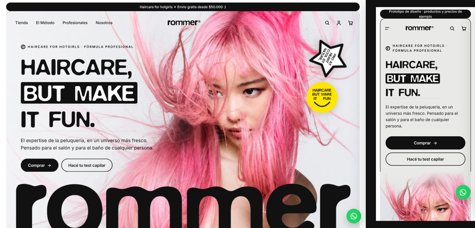

# Rommer: prototipo web e-commerce

Prototipo navegable (HTML/CSS/JS) de la tienda online de **Rommer**, cuidado capilar con actitud de marca de consumo. Versión 4: base blanco y negro, hero con foto completa, productos reales y sección de Instagram.

- `index.html`: Home (18 secciones)
- `producto.html#shampoo-keratin`: ficha de producto (cambiá el `#` por otro producto)
- Changuito lateral con envío gratis, descuento de kit y cuotas

> Prototipo de diseño: productos, precios y algunos textos son de ejemplo.

Más detalles en [LEEME.md](LEEME.md).
